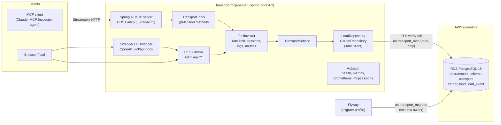

# Transport MCP server

[](https://github.com/mr-mtd/springboot_MCP_server/actions/workflows/build.yml)


A Spring Boot [MCP](https://modelcontextprotocol.io) server that exposes read-only tools over a
synthetic freight database in PostgreSQL: carriers, loads, and load tracking events. It's a
learning project.

- Java 21, Spring Boot 4.2, Spring AI 2.1 (`spring-ai-starter-mcp-server-webmvc`)
- Transport: Streamable HTTP at `POST /mcp`
- Database: PostgreSQL (Amazon RDS in us-east-2), queried with `JdbcClient`, schema managed by Flyway

## Architecture



The MCP endpoint and the REST API go through the same `ToolInvoker` to the same `TransportService`
methods, so they return the same data and share the rate limit, logging and metrics. The server only ever connects as the read-only `transport_mcp` user; schema changes
go through Flyway under a separate profile and user.

## Tools

| Tool | Inputs | Returns |
| --- | --- | --- |
| `getLoadStatus` | `loadNumber` (`LD-000420`, or just `420`) | Status, carrier, lane, scheduled vs actual times, hours late, latest event |
| `getCarrierDetails` | `carrierId` or `mcNumber` (exactly one) | Carrier profile, open loads, deliveries and on-time % over the last 90 days |
| `findDelayedShipments` | all optional: `minHoursLate` (2), `carrierId`, `originState`, `destinationState`, `includeDelivered` (false), `limit` (20, max 100) | Late loads, most late first, with the latest reported delay reason |

**Late** means strictly more than 2 hours past `delivery_scheduled_at`, measured against
`delivered_at`, or against now while the load is still on the road. That rule lives in one place,
[`DelayRule`](src/main/java/io/github/mrmtd/transport/repo/DelayRule.java), and every tool uses it:
`getLoadStatus`'s `late` flag, `findDelayedShipments`' filter and `getCarrierDetails`' on-time
percentage all compare the **raw** hours with `>`. Hours are rounded to one decimal only when they're
put in a response, so a load 2.04 hours late is late and shows `hoursLate: 2.0`.
`findDelayedShipments` returns loads more than `minHoursLate` hours late, and never on-time loads.

All tools are annotated `readOnlyHint = true` and return records, so clients get an `outputSchema`
and `structuredContent`. Bad input or an unknown id comes back as a tool result with
`isError: true` and a readable message, so the calling model can correct itself.

## Sessions, rate limits, logs and metrics

Every tool call, from MCP or from the REST API, goes through
[`ToolInvoker`](src/main/java/io/github/mrmtd/transport/invocation/ToolInvoker.java), so they all get
the same treatment.

**Stateful MCP sessions.** The Streamable HTTP transport is stateful: `initialize` returns an
`Mcp-Session-Id` that the client sends on every request, and `DELETE /mcp` ends the session. The
server pings open sessions every 30 s. On top of that,
[`McpSessionRegistry`](src/main/java/io/github/mrmtd/transport/session/McpSessionRegistry.java) keeps
per-session state (client name and version, start time, last seen, tool calls by tool). State goes
away on `DELETE` or after 30 minutes idle (`MCP_SESSION_IDLE_TIMEOUT`). See it at
`GET /actuator/mcpsessions`.

**Rate limit.** A token bucket per caller: per MCP session, or per client IP for `/api`. The default
allows bursts of 20 calls, then 2 per second. Over the limit, MCP returns a tool error saying when to
retry, and REST returns `429` with `Retry-After`. Settings: `RATE_LIMIT_CAPACITY`,
`RATE_LIMIT_REFILL_PER_SECOND`, `RATE_LIMIT_ENABLED`.

**Logs.** Every line written during a tool call carries the transport, tool and MCP session, and
each call ends with one line saying how it went:

```
INFO [mcp/getLoadStatus session=632f0ce5-…] ToolInvoker : tool=getLoadStatus outcome=success durationMs=5
INFO [mcp/getLoadStatus session=40ee8e90-…] ToolInvoker : tool=getLoadStatus outcome=not_found durationMs=1 message="No load found with load number LD-999999"
INFO [/ session=632f0ce5-…] McpSessionRegistry : MCP session closed by client mcpSession=632f0ce5-… toolCalls=3 lasted=PT4M12S
```

Session start, close and expiry are logged. Rate-limited calls log a WARN and unexpected errors log
an ERROR with the stack trace. Repository queries log their name, row count and duration at DEBUG
(`LOG_LEVEL=DEBUG`), and any query over 1 s logs a WARN, since the DB user's statement timeout is 5 s.

**Metrics** at `/actuator/metrics` and `/actuator/prometheus`:

| Metric | Type | Tags |
| --- | --- | --- |
| `transport.tool.invocations` | timer: count, total and max duration, histogram | `tool`, `transport` (`mcp`/`rest`), `outcome` |
| `transport.tool.failures` | counter, for every outcome except success | same |
| `transport.mcp.sessions.active` | gauge | |

Outcomes are `success`, `invalid_input`, `not_found`, `rate_limited` and `error`. For example, the
p95 duration per tool in Prometheus is
`histogram_quantile(0.95, sum by (tool, le) (rate(transport_tool_invocations_seconds_bucket[5m])))`.

## Database

```
carrier 1 ──< load 1 ──< load_event
```

| File | Run as | Purpose |
| --- | --- | --- |
| [`db/roles.sql`](db/roles.sql) | RDS master (`postgres`), once | Creates `transport_migrator` (owns the schema) and `transport_mcp` (read-only, 5 s statement timeout) |
| [`V1__schema.sql`](src/main/resources/db/migration/V1__schema.sql) | `transport_migrator` | Tables, constraints, indexes |
| [`V2__seed.sql`](src/main/resources/db/migration/V2__seed.sql) | `transport_migrator` | 50 carriers, 2,000 loads, about 13k events. Same data every run; dates relative to `now()` |

The server connects as **`transport_mcp`**, so even a buggy tool can't change data.

## Running it

### Against RDS

Download the RDS certificate bundle once:

```bash
curl -o ~/global-bundle.pem https://truststore.pki.rds.amazonaws.com/global/global-bundle.pem
```

Then start the server as the read-only user:

```bash
export DB_URL="jdbc:postgresql://transport-db.cps0062uqgpv.us-east-2.rds.amazonaws.com:5432/transport?sslmode=verify-full&sslrootcert=$HOME/global-bundle.pem"
export DB_USERNAME=transport_mcp
export DB_PASSWORD='...'        # single quotes, so the shell leaves special characters alone
mvn spring-boot:run
```

The server listens on `http://localhost:8080/mcp`. Swagger UI: `http://localhost:8080/swagger`. Health: `http://localhost:8080/actuator/health`.

### In Docker

The [`Dockerfile`](Dockerfile) is multi-stage: Maven builds the jar, then it runs on a JRE-only image as a
non-root user. The image already has the RDS certificate bundle at `/app/certs/global-bundle.pem`.

```bash
docker build -t transport-mcp-server .

docker run --rm -p 8080:8080 \
  -e DB_URL="jdbc:postgresql://transport-db.cps0062uqgpv.us-east-2.rds.amazonaws.com:5432/transport?sslmode=verify-full&sslrootcert=/app/certs/global-bundle.pem" \
  -e DB_USERNAME=transport_mcp \
  -e DB_PASSWORD \
  transport-mcp-server
```

`-e DB_PASSWORD` with no value passes through the variable from your shell, so the password isn't
typed on the command line. Tests aren't run inside the image build (they need Docker themselves);
CI runs them with `mvn verify` and then checks that the image builds.

### On AWS

It runs on a free-tier EC2 instance with no inbound ports, next to RDS. CI publishes the image to
GHCR. See [`deploy/ec2/README.md`](deploy/ec2/README.md).

### Migrations

The runtime user can't write, so Flyway only runs under the `migrate` profile, as `transport_migrator`:

```bash
export MIGRATOR_PASSWORD='...'
mvn spring-boot:run -Dspring-boot.run.profiles=migrate
```

On the RDS database, where V1 and V2 were run by hand, the first migrate run records a baseline at
version 2 and changes nothing. New migrations go in `src/main/resources/db/migration` as `V3__...sql`.

To refresh the synthetic data (dates move forward to today), run `V2__seed.sql` again as
`transport_migrator`. It clears the three tables first.

## Trying the tools

**MCP Inspector** (needs Node):

```bash
npx @modelcontextprotocol/inspector
```

Choose transport **Streamable HTTP**, URL `http://localhost:8080/mcp`, then **Connect** and open **Tools**.

**Raw JSON-RPC with curl**, to see what an MCP client actually sends:

```bash
H=(-H 'Content-Type: application/json' -H 'Accept: application/json, text/event-stream')

# 1. initialize; the response header Mcp-Session-Id identifies the session
curl -si "${H[@]}" localhost:8080/mcp \
  -d '{"jsonrpc":"2.0","id":1,"method":"initialize","params":{"protocolVersion":"2025-06-18","capabilities":{},"clientInfo":{"name":"curl","version":"1"}}}'

SID=...   # paste the Mcp-Session-Id value

# 2. tell the server we're ready
curl -s "${H[@]}" -H "Mcp-Session-Id: $SID" localhost:8080/mcp -d '{"jsonrpc":"2.0","method":"notifications/initialized"}'

# 3. call a tool
curl -s "${H[@]}" -H "Mcp-Session-Id: $SID" localhost:8080/mcp \
  -d '{"jsonrpc":"2.0","id":2,"method":"tools/call","params":{"name":"findDelayedShipments","arguments":{"limit":3}}}'
```

## Swagger UI and the REST API

The MCP endpoint speaks JSON-RPC, which Swagger can't describe, so each tool also has a plain
`GET` endpoint under `/api` that calls the same method. Open **http://localhost:8080/swagger** to
try them in the browser. The OpenAPI document is at `/v3/api-docs`.

| Endpoint | Same as |
| --- | --- |
| `GET /api/loads/{loadNumber}` | `getLoadStatus` |
| `GET /api/carriers/{carrierId}` | `getCarrierDetails` by id |
| `GET /api/carriers?mcNumber=MC155433` | `getCarrierDetails` by MC number |
| `GET /api/shipments/delayed?minHoursLate=&carrierId=&originState=&destinationState=&includeDelivered=&limit=` | `findDelayedShipments` |

Errors come back as RFC 9457 problem details: an unknown id is `404`, bad input is `400`.

```bash
curl -s localhost:8080/api/loads/420
curl -s 'localhost:8080/api/shipments/delayed?originState=TX&limit=3'
```

## Tests

```bash
mvn test
```

The tests need Docker. They start Postgres 18 with Testcontainers, set it up like RDS (same two
users, Flyway as `transport_migrator`, app as `transport_mcp`), and then:

- call each tool method directly against the seeded data
- start the server on a random port and call it with the MCP Java SDK client (`initialize`,
  `tools/list`, `tools/call`), checking `structuredContent`, output schemas and `isError` results
- call the REST mirror and check its 404/400 mapping and the OpenAPI document
- check that "late" agrees across all three tools, at the 2-hour boundary too
- check per-session state, the rate limit (MCP tool error and REST 429), and the metrics

GitHub Actions runs `mvn verify` (with these tests) on every push to `main` and `feature/dev` and on
every pull request: [`.github/workflows/build.yml`](.github/workflows/build.yml).
